# 📨 Classificador de Mensagens com IA

Solução que usa **Inteligência Artificial (Google Gemini)**, uma **API em Python (FastAPI)** e um **fluxo de automação no n8n** para ler, classificar e encaminhar automaticamente mensagens de clientes para o setor responsável.

> Projeto desenvolvido para o **Desafio Técnico — IA e Automação (KODIE)**.

---

## 1. Apresentação da Ideia

A ideia surgiu ao observar como pequenas empresas recebem diariamente dezenas de mensagens de clientes (dúvidas, reclamações, pedidos e elogios) e dependem de uma pessoa para ler cada uma, entender o assunto e repassar ao setor certo. Esse trabalho é repetitivo, consome tempo e atrasa o atendimento justamente das mensagens mais urgentes.

## 2. Problema Escolhido

Foi escolhido o caso **4.1 — Classificação de Mensagens**.

Uma empresa recebe mensagens de clientes com diferentes tipos de solicitação, mas não tem um processo organizado para identificar o assunto de cada uma. Isso gera:

- tempo gasto lendo e encaminhando mensagens manualmente;
- mensagens urgentes (como cobranças indevidas) esperando na fila junto com dúvidas simples;
- falta de histórico organizado dos atendimentos.

## 3. Solução Proposta

A solução automatiza a triagem em três camadas:

1. **n8n** recebe a mensagem do cliente por um Webhook.
2. **API em FastAPI** envia a mensagem ao **Gemini** com um prompt estruturado.
3. **A IA** devolve um JSON padronizado com:
   - **categoria**: `duvida`, `reclamacao`, `solicitacao`, `elogio` ou `outro`
   - **setor**: `financeiro`, `suporte`, `comercial` ou `atendimento_geral`
   - **prioridade**: `baixa`, `media` ou `alta`
   - **sentimento**: `positivo`, `neutro` ou `negativo`
   - **resumo**: uma frase descrevendo o pedido
4. **O n8n** usa o setor para encaminhar a mensagem ao responsável, salva o atendimento numa tabela e responde a quem enviou.

A IA é responsável pela parte que exige **interpretação de linguagem** (entender o assunto, a urgência e o tom). A automação cuida da parte **operacional** (rotear, registrar e responder).

## 4. Tecnologias Utilizadas

| Tecnologia | Uso no projeto |
|---|---|
| **Python 3** | Linguagem do back-end |
| **FastAPI** | Criação da API REST |
| **Uvicorn** | Servidor da API |
| **Pydantic** | Validação dos dados de entrada e da resposta da IA |
| **Google Gemini API** (`google-genai`) | Modelo de IA que classifica as mensagens |
| **python-dotenv** | Leitura das variáveis de ambiente (`.env`) |
| **n8n** | Fluxo de automação (Webhook, Switch, Data Table) |
| **Git / GitHub** | Versionamento e entrega |

## 5. Funcionamento do Sistema

### Arquitetura

```
Cliente (curl / site / app)
        │  POST { mensagem, remetente }
        ▼
┌──────────────────────────────── n8n ────────────────────────────────┐
│ Webhook → HTTP Request ──────────────► API FastAPI ──► Gemini        │
│                 ◄──────── JSON classificado ◄──────┘                 │
│                 │                                                    │
│                 ▼                                                    │
│              Switch (por setor)                                      │
│     ┌───────────┼────────────┬──────────────┐                        │
│     ▼           ▼            ▼              ▼                        │
│ Financeiro   Suporte     Comercial        Geral   (Edit Fields)      │
│     └───────────┴─────┬──────┴──────────────┘                        │
│                       ▼                                              │
│              Salvar Atendimento (Data Table)                         │
│                       ▼                                              │
│              Respond to Webhook ──────────────────────────► Cliente  │
└──────────────────────────────────────────────────────────────────────┘
```

### Como a API recebe os dados

A API expõe dois endpoints:

| Método | Rota | Descrição |
|---|---|---|
| `GET` | `/health` | Verifica se a API está no ar |
| `POST` | `/classificar` | Recebe a mensagem e devolve a classificação |

**Exemplo de requisição:**

```json
{
  "mensagem": "Fui cobrado duas vezes no cartão, quero o estorno urgente!",
  "remetente": "maria@email.com"
}
```

**Exemplo de resposta:**

```json
{
  "remetente": "maria@email.com",
  "mensagem_original": "Fui cobrado duas vezes no cartão, quero o estorno urgente!",
  "classificacao": {
    "categoria": "reclamacao",
    "setor": "financeiro",
    "prioridade": "alta",
    "sentimento": "negativo",
    "resumo": "Cliente cobrado em duplicidade solicita estorno urgente."
  }
}
```

A entrada é validada pelo Pydantic (`app/schemas.py`): mensagens vazias ou muito curtas são rejeitadas com erro **422**.

### Como a IA processa as informações

O arquivo `app/ia.py` contém o **prompt estruturado**, que define:

- **Papel:** a IA atua como assistente de triagem de atendimento.
- **Regras claras** para cada campo (o que caracteriza cada categoria, setor e prioridade).
- **Exemplos (few-shot)** de mensagens e das saídas esperadas.

Para garantir que a resposta venha **sempre no formato correto**, foram usadas três camadas de proteção:

1. **Saída estruturada do Gemini** (`response_schema`): o modelo é obrigado a responder no formato do schema `Classificacao`.
2. **Valores restritos** com `Literal`: a IA não pode inventar categorias ou setores fora da lista.
3. **Validação com Pydantic** (`model_validate_json`): uma segunda checagem do nosso lado.

Também foi usada `temperature=0` para que a mesma mensagem receba sempre a mesma classificação. Se a IA falhar, a API devolve erro **502** com a descrição do problema, em vez de quebrar.

### Como a automação é executada

| Node | Função |
|---|---|
| **Webhook** | Porta de entrada: recebe a mensagem via `POST /webhook/nova-mensagem` |
| **HTTP Request** | Envia a mensagem para a API (`/classificar`) e recebe a classificação da IA |
| **Switch** | Lê o campo `classificacao.setor` e direciona para uma de 4 saídas |
| **Encaminhar (×4)** | Adiciona o e-mail do responsável de cada setor |
| **Salvar Atendimento** | Grava o atendimento na Data Table `atendimentos` |
| **Responder** | Devolve a quem enviou o registro do atendimento salvo |

O fluxo exportado está em [`n8n/triagem-mensagens.json`](n8n/triagem-mensagens.json).

## 6. Como Executar

### Pré-requisitos

- Python 3.10+
- Node.js 20+ (para o n8n)
- Uma chave de API do Gemini, gerada gratuitamente em <https://aistudio.google.com/apikey>

### 6.1. Clonar e configurar a API

```bash
git clone https://github.com/milenaagostinho/classificador-mensagens.git
cd classificador-mensagens

python -m venv venv
source venv/bin/activate        # Windows: venv\Scripts\activate

pip install -r requirements.txt
```

Crie o arquivo `.env` a partir do exemplo e preencha sua chave:

```bash
cp .env.example .env
```

```
GEMINI_API_KEY=sua_chave_aqui
GEMINI_MODEL=nome_do_modelo_gemini
```

### 6.2. Rodar a API

```bash
uvicorn app.main:app --reload
```

- Health check: <http://127.0.0.1:8000/health>
- Documentação interativa: <http://127.0.0.1:8000/docs>

### 6.3. Rodar o n8n

Em **outro terminal**:

```bash
npm install -g n8n
n8n start
```

Acesse <http://localhost:5678> e:

1. Em **Overview → Data tables**, crie a tabela **`atendimentos`** com as colunas (String): `remetente`, `mensagem`, `categoria`, `setor`, `prioridade`, `sentimento`, `resumo`, `responsavel`.
2. Em **Workflows → Import from File**, importe `n8n/triagem-mensagens.json`.
3. Abra o node **Salvar Atendimento** e selecione novamente a tabela `atendimentos` (o ID da tabela muda em cada instalação).
4. Ative o workflow (botão **Active**).

### 6.4. Testar

```bash
curl -X POST http://localhost:5678/webhook/nova-mensagem \
  -H "Content-Type: application/json" \
  -d '{"mensagem": "Fui cobrado duas vezes no cartão, quero o estorno urgente!", "remetente": "maria@email.com"}'
```

Outras mensagens para testar cada setor:

| Mensagem | Setor esperado |
|---|---|
| "Fui cobrado duas vezes no cartão, quero o estorno urgente!" | financeiro |
| "Não consigo fazer login no app desde a atualização" | suporte |
| "Vocês têm plano para empresas com 50 funcionários?" | comercial |
| "Adorei o atendimento da Júlia, muito atenciosa!" | atendimento_geral |

> Com o workflow em modo de teste (botão "Execute workflow"), use a URL `/webhook-test/nova-mensagem`. Com o workflow ativo, use `/webhook/nova-mensagem`.

### 6.5. Problemas comuns

| Problema | Causa | Solução |
|---|---|---|
| API retorna **502** | Nome do modelo inválido ou chave incorreta no `.env` | Confira o código exato do modelo no AI Studio e reinicie o uvicorn após editar o `.env` |
| n8n: *"The service refused the connection"* | Em versões recentes do Node.js, `localhost` é resolvido como IPv6 (`::1`), mas o uvicorn escuta em IPv4 | Use `http://127.0.0.1:8000/classificar` no HTTP Request |
| n8n: *"Workflow could not be started"* | Webhook configurado para responder via "Respond to Webhook", mas o node não existe ou não está conectado | Conecte o node **Responder** ao final do fluxo |
| Erro de versão ao instalar o n8n | Node.js antigo | Atualize o Node.js (ex.: `nvm install 24`) |

---

## 7. Documentação do Fluxo de Automação

### 7.1. Fluxo completo

Visão geral de todos os nodes conectados: a mensagem entra pelo Webhook, é classificada pela API, separada por setor, salva e respondida.

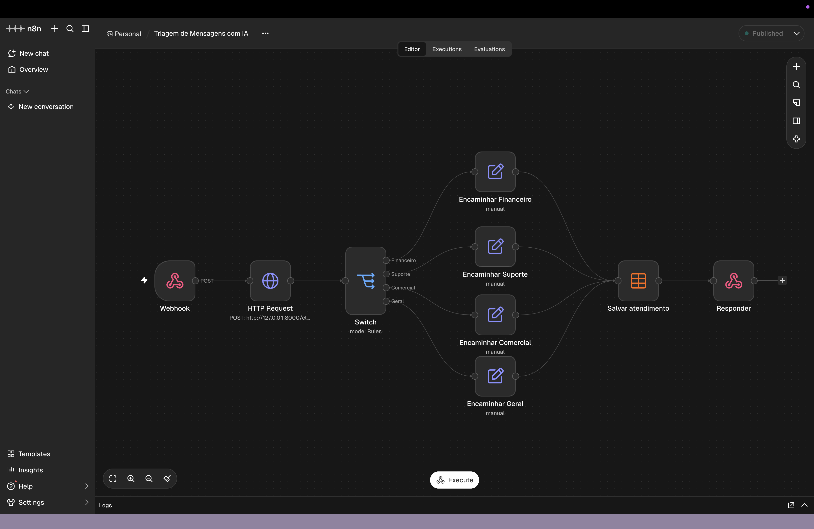

### 7.2. Execução bem-sucedida

Execução concluída com sucesso. Os nodes em verde mostram o caminho percorrido pela mensagem (neste exemplo, o setor Financeiro).

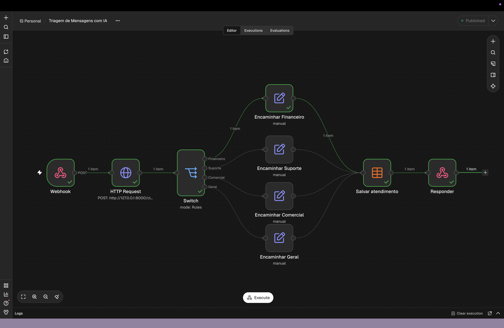

### 7.3. Configuração dos nodes

**Webhook:** recebe requisições `POST` no caminho `nova-mensagem` e só responde ao final do fluxo, por meio do node "Responder".

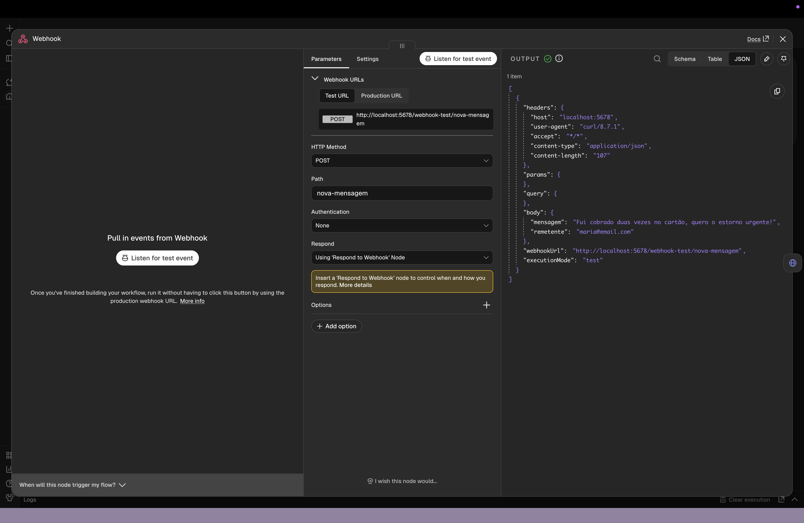

**HTTP Request:** envia `mensagem` e `remetente` (vindos do Webhook) para a API em `/classificar`.

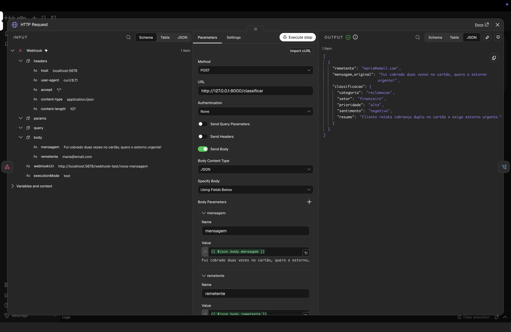

**Switch:** quatro regras que comparam `classificacao.setor` com cada setor e direcionam para a saída correspondente.

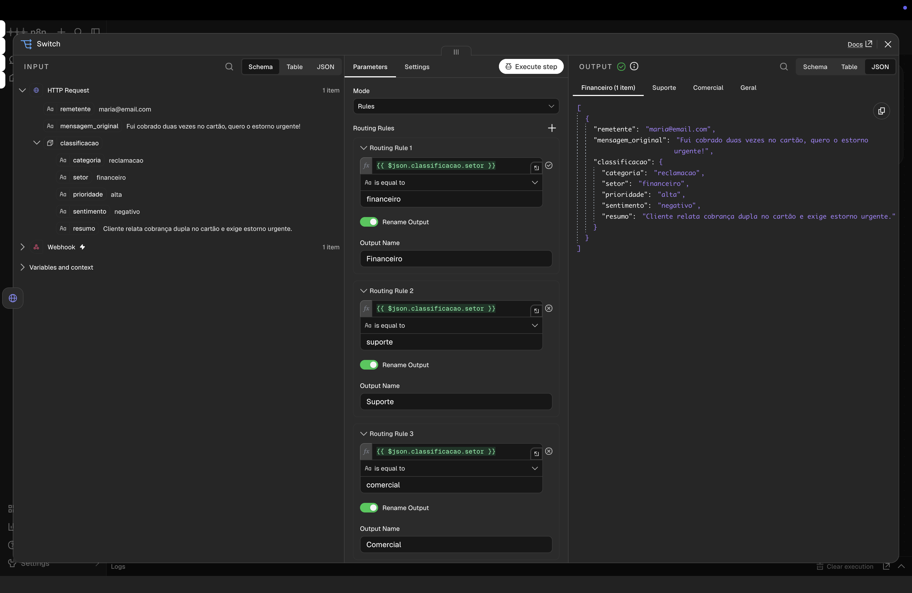

**Encaminhar (Edit Fields):** adiciona o campo `responsavel` com o e-mail do setor, mantendo todos os dados da classificação.

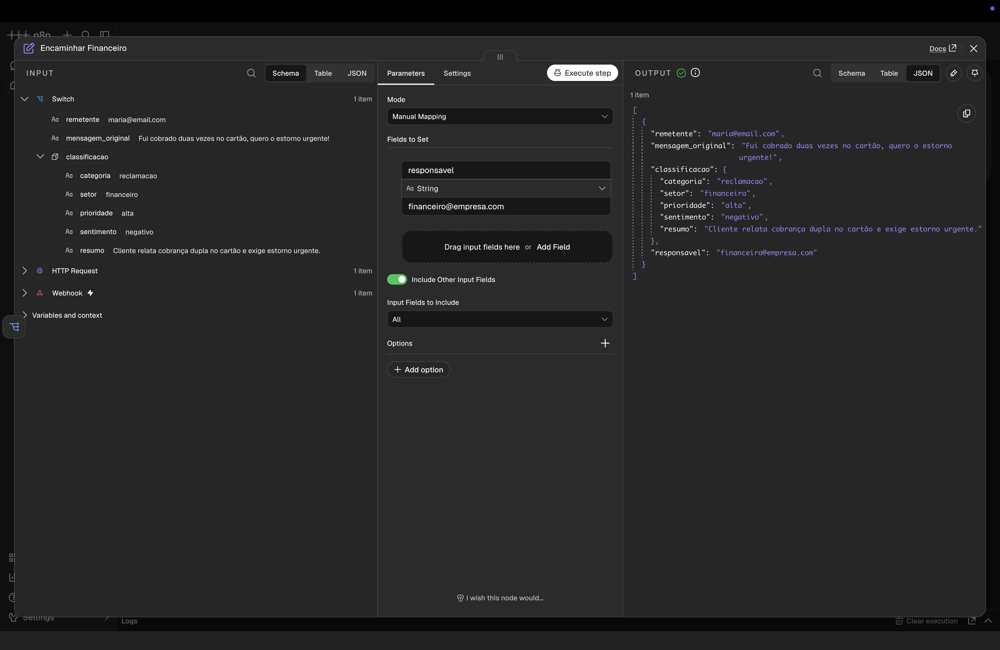

**Salvar Atendimento (Data Table):** mapeia cada campo da classificação para uma coluna da tabela `atendimentos`.

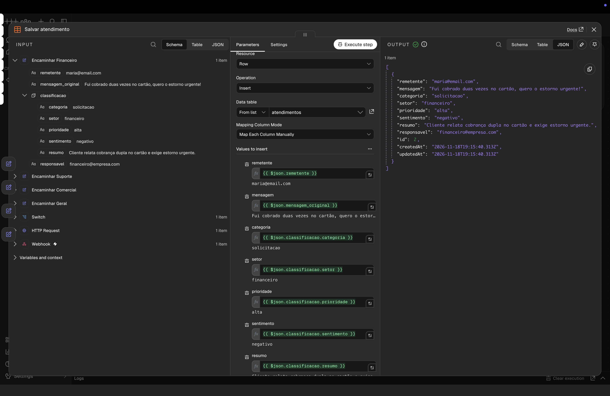

**Responder (Respond to Webhook):** devolve a quem enviou o registro do atendimento salvo.

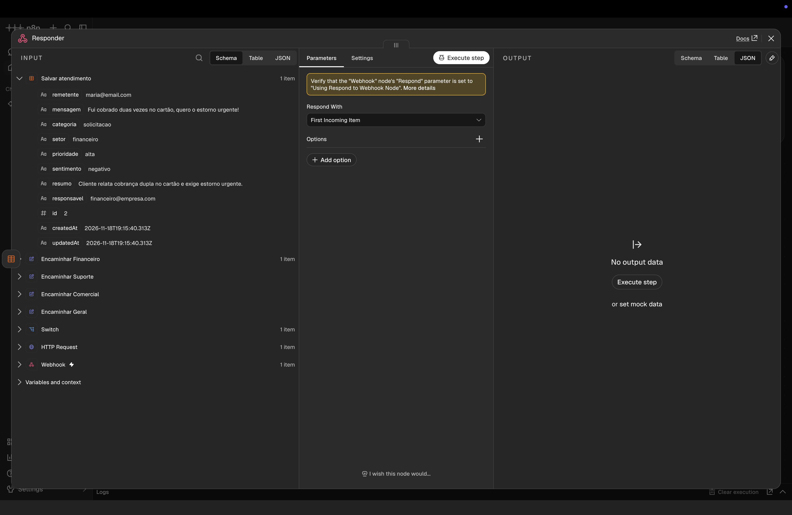

### 7.4. Resultados

**Resposta da IA recebida pelo n8n:** saída do node HTTP Request com a classificação gerada pelo Gemini.

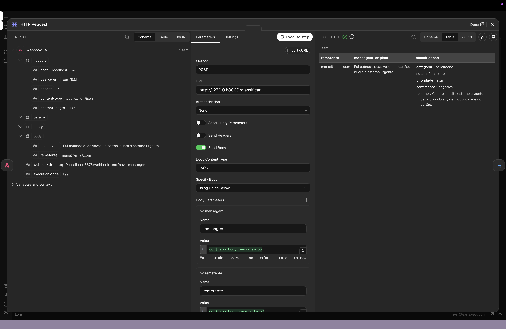

**Atendimentos registrados:** a tabela com as mensagens de teste, cada uma classificada e encaminhada ao setor correto.

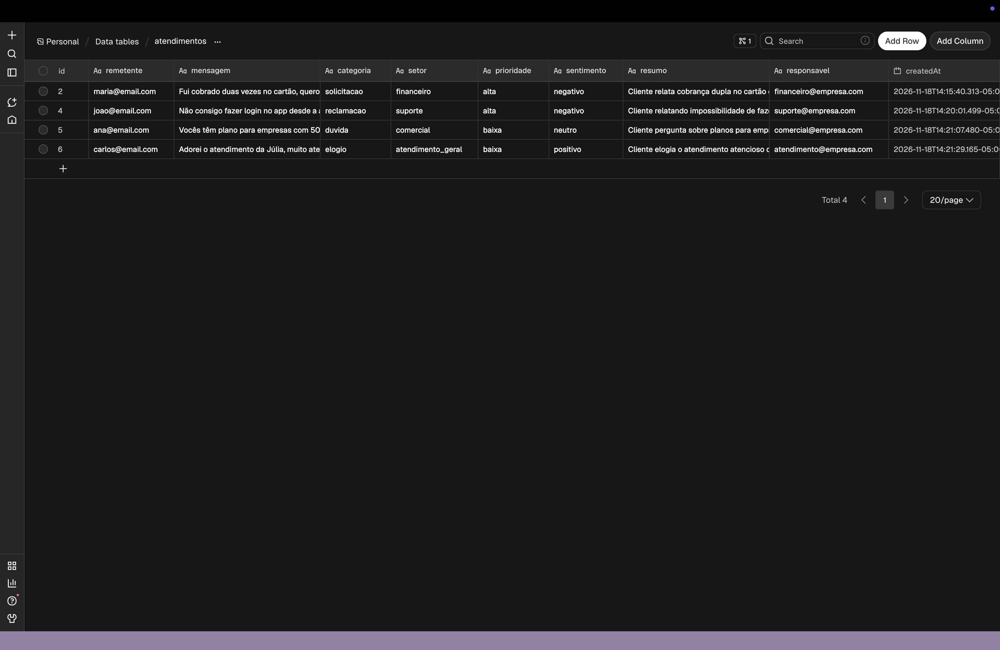

**Resposta recebida pelo cliente:** retorno do Webhook no terminal após o processamento completo.

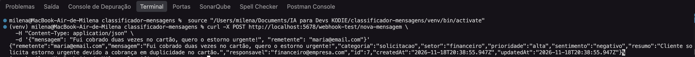

---

## 📁 Estrutura do Projeto

```
classificador-mensagens/
├── app/
│   ├── __init__.py
│   ├── main.py          # Rotas da API (FastAPI)
│   ├── ia.py            # Prompt estruturado e integração com o Gemini
│   └── schemas.py       # Modelos Pydantic (entrada e saída)
├── n8n/
│   └── triagem-mensagens.json   # Fluxo exportado do n8n
├── docs/
│   └── prints/          # Capturas de tela do fluxo
├── .env.example         # Modelo das variáveis de ambiente (sem chaves)
├── .gitignore
├── requirements.txt
└── README.md
```

## 🔒 Segurança

- A chave da API **não** está no repositório. Ela é lida do arquivo `.env`, que está no `.gitignore`.
- O arquivo `.env.example` mostra apenas os **nomes** das variáveis necessárias.

## 🚀 Melhorias Futuras

<!-- ✏️ Opcional: ajuste ou remova -->
- Enviar e-mail ou mensagem (Slack/Telegram) real para cada setor.
- Tratar falhas da IA no fluxo com uma rota de erro no n8n.
- Executar a API e o n8n com Docker Compose.
- Criar um painel com indicadores dos atendimentos (volume por setor, prioridade etc.).

## 📄 Licença

Este projeto está sob a licença [MIT](LICENSE).
